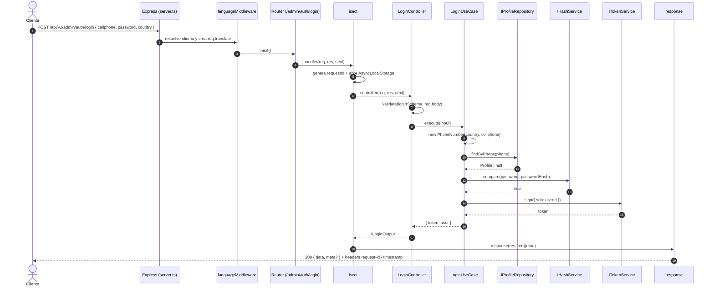
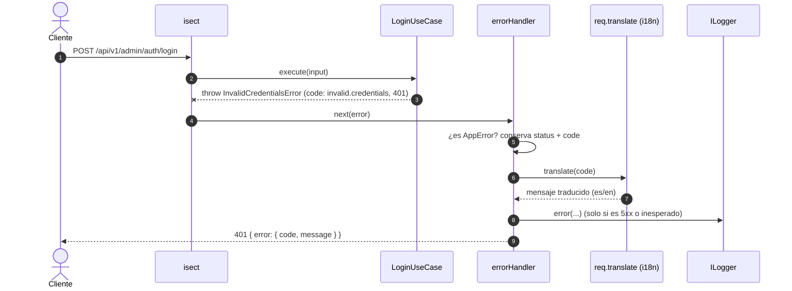
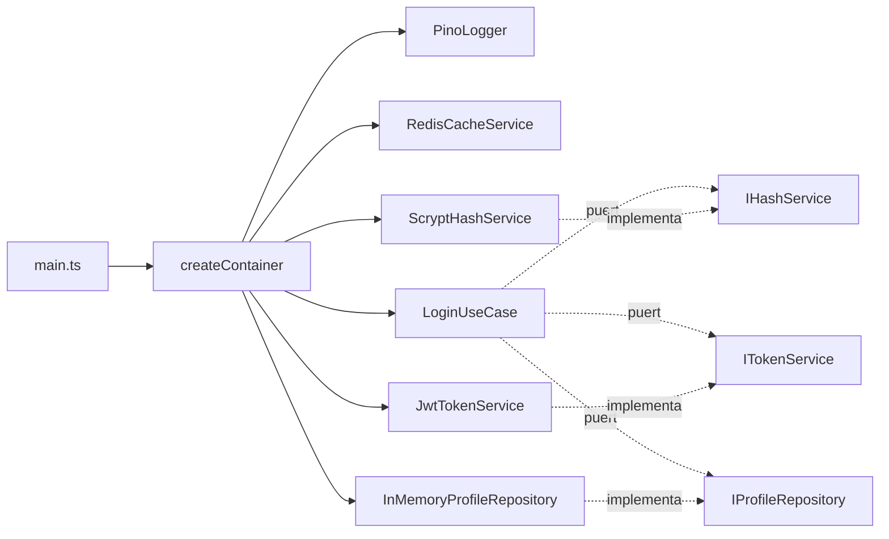

# Arquitectura

Este proyecto sigue **Clean Architecture**. La regla de dependencia es única:
_las dependencias apuntan siempre hacia dentro_. El dominio no conoce frameworks,
ni base de datos, ni HTTP.

```
        ┌─────────────────────────────────────────────┐
        │                 DOMAIN                       │  ← núcleo puro
        │  entities · value-objects · ports · errors   │
        └───────────────▲─────────────────────────────┘
                        │
        ┌───────────────┴─────────────────────────────┐
        │               APPLICATION                    │
        │  use-cases · dtos · ports de servicios        │
        └───────────────▲─────────────────────────────┘
                        │
        ┌───────────────┴───────────────┬─────────────┐
        │        INFRASTRUCTURE          │ PRESENTATION│
        │  prisma/in-memory · redis      │ express     │
        │  pino · scrypt · jwt · env     │ controllers │
        └────────────────────────────────┴─────────────┘
                        │
                 COMPOSITION ROOT (DI container)
```

## Capas

### `src/domain`
Entidades, value objects, errores de negocio y **puertos** (interfaces) de
repositorios. Sin dependencias externas: solo TypeScript.

- `entities/Profile.ts` — agregado raíz.
- `value-objects/Email.ts`, `PhoneNumber.ts` — validación inmutable.
- `errors/DomainError.ts` — errores de negocio con `code` i18n y status HTTP.
- `repositories/IProfileRepository.ts` — puerto de persistencia.

### `src/application`
Casos de uso y puertos de servicios técnicos. Depende **solo** del dominio.

- `use-cases/auth/LoginUseCase.ts` — orquestación pura.
- `ports/` — `IHashService`, `ITokenService`, `ICacheService`, `ILogger`.
- `dtos/auth/LoginDto.ts` — validación de entrada y forma de salida.

### `src/infrastructure`
Implementaciones concretas de los puertos.

- `config/env.ts` — validación de variables de entorno con Zod.
- `logging/PinoLogger.ts` — Pino + Axiom (con redacción de campos sensibles).
- `services/ScryptHashService.ts` — hashing con `scrypt` nativo.
- `services/JwtTokenService.ts` — JWT HS256 sin dependencias.
- `services/RedisCacheService.ts` — caché con *fallback* a memoria.
- `persistence/in-memory/` — repositorio en memoria + seed (B1).

### `src/presentation`
Adaptadores de entrada (HTTP/Express).

- `container/container.ts` — **composition root**: único lugar que conoce las
  implementaciones concretas y ensambla el grafo.
- `http/isect.ts` — adapta un `Controller` a un handler de Express.
- `http/response.ts` — envelope estándar `{ data, meta? }`.
- `http/errors/errorHandler.ts` — traduce errores a respuestas HTTP + i18n.
- `http/routes/` — definición de rutas versionadas.
- `http/controllers/` — controladores finos.

### `src/shared`
Código transversal sin reglas de negocio: constantes, i18n, validación,
contexto de request.

## Flujo de una petición

```
HTTP → route → isect(controller) → validate(DTO) → use-case → repository (puerto)
                                              ↓
                                         errorHandler → respuesta HTTP + i18n
```

### Secuencia: login exitoso



### Secuencia: error de negocio



### Composition root: quién construye a quién



## Cómo cambiar la persistencia

Toda la persistencia se inyecta en `src/presentation/container/container.ts`.
Para migrar de memoria a Prisma basta con crear un `PrismaProfileRepository`
que implemente `IProfileRepository` y cambiar **una línea** en el container.

## Testing

- `tests/unit/` — casos de uso con fakes (sin HTTP ni BD).
- `tests/e2e/` — rutas con `supertest` contra un container real.
